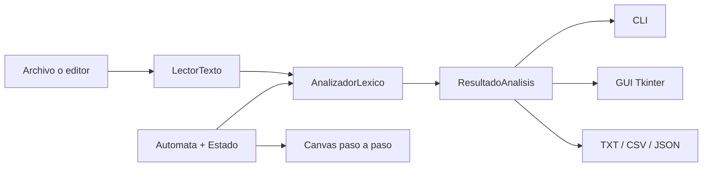

# Arquitectura del sistema

## Responsabilidades

- `src/modelos`: datos inmutables (`Token`, `DiagnosticoLexico`, `ResultadoAnalisis`) y AFD reutilizable.
- `src/analizadores/reconocedores.py`: definición formal de estados y transiciones.
- `src/analizadores/analizador_lexico.py`: barrido, selección de reconocedor, vocabulario y recuperación.
- `src/core/lector_texto.py`: archivos UTF-8 y posiciones por carácter.
- `src/core/exportador.py`: serialización sin recalcular el análisis.
- `src/cli.py`: argumentos, tabla y códigos de salida.
- `src/gui`: editor, resaltado, resultados, diagnósticos y simulador AFD.
- `analizador_sintactico.py` y `analizador_semantico.py`: contratos preservados para fases posteriores.

La dependencia apunta hacia los modelos: GUI, CLI y exportadores no duplican reglas léxicas. El visualizador recibe las mismas instancias de `Automata` expuestas por `AnalizadorLexico`.
