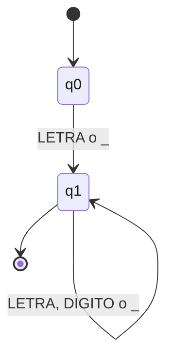
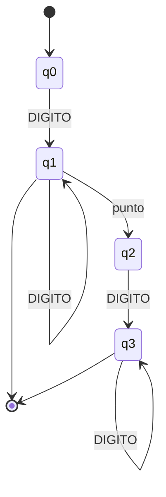
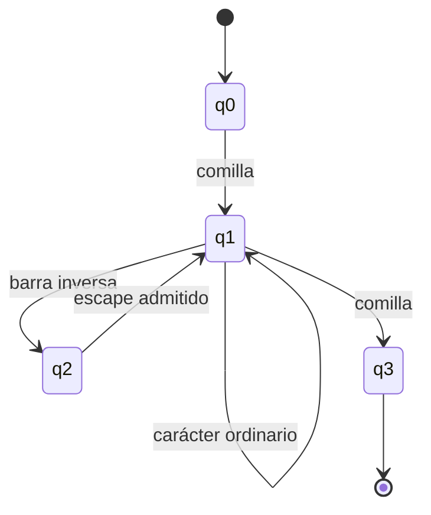

# Autómatas y tablas de transición

Los tres AFD son creados en `src/analizadores/reconocedores.py` y los consumen tanto el lexer como el visualizador. Una transición inexistente representa rechazo.

## Identificador

| Estado | LETRA | DÍGITO | `_` | Acepta |
|---|---|---|---|---|
| `q0` | `q1` | — | `q1` | No |
| `q1` | `q1` | `q1` | `q1` | Sí |

## Número

| Estado | DÍGITO | `.` | Acepta |
|---|---|---|---|
| `q0` | `q1` | — | No |
| `q1` | `q1` | `q2` | Sí: entero |
| `q2` | `q3` | — | No |
| `q3` | `q3` | — | Sí: decimal |

## Cadena

| Estado | Comilla | Barra | Ordinario | Escape válido | Acepta |
|---|---|---|---|---|---|
| `q0` | `q1` | — | — | — | No |
| `q1` | `q3` | `q2` | `q1` | — | No |
| `q2` | — | — | — | `q1` | No |
| `q3` | — | — | — | — | Sí |

El escáner añade diagnósticos y recuperación alrededor de este modelo formal: un escape inválido produce `LEX004`, y salto/EOF antes de `q3` produce `LEX002`.
